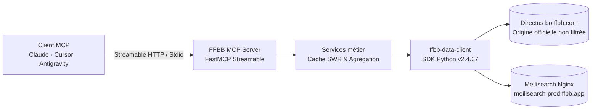

<div align="center">

# 🏀 FFBB MCP Server

**Le basket français officiel, directement dans vos assistants IA.**

Serveur [MCP](https://modelcontextprotocol.io) pour consulter calendriers, classements, bilans, résultats, scores live et règlements officiels de la FFBB (Fédération Française de Basketball).

> 🇺🇸 **English Summary**: Official Model Context Protocol (MCP) server for French Basketball (FFBB). Connect your AI assistants (Claude, Cursor, Copilot, ChatGPT, Antigravity) to live French basketball schedules, standings, scores, team records, club directories, and official federal regulations via Streamable HTTP or Stdio.

[🌐 Site](https://ffbb.desimone.fr) ·
[🧩 Extension VS Code](https://github.com/nickdesi/FFBB-MCP-Server/releases/latest) ·
[📚 Documentation](https://ffbb.desimone.fr/#tools) ·
[💬 Support](SUPPORT.md)

<br />

[](https://github.com/nickdesi/FFBB-MCP-Server/releases/latest)
[](https://www.python.org)
[](https://github.com/nickdesi/FFBB-MCP-Server/actions/workflows/ci.yml)
[](https://modelcontextprotocol.io)
[](https://glama.ai/mcp/servers/nickdesi/FFBB-MCP-Server)
[](LICENSE)
[](https://github.com/nickdesi/FFBB-MCP-Server/stargazers)

</div>

---

<p align="center">
  ⭐ <b>Si ce serveur MCP FFBB vous est utile pour vos assistants IA, n'hésitez pas à laisser une étoile sur GitHub !</b> ⭐
</p>

---

## ⚡ Démarrage express (< 2 min)

> [!TIP]
> **Aucune installation requise** : le serveur est hébergé publiquement. Ajoutez simplement l'endpoint MCP à votre client :

```text
https://ffbb.desimone.fr/mcp
```

Puis posez vos questions en langage naturel :

> _« Quel est le prochain match des U15 de mon club (nommer le club) ? »_
> _« Donne-moi le classement de la poule des U15M2 du Stade Clermontois et le dernier résultat. »_
> _« Y a-t-il des matchs en direct ce soir ? »_

👉 Voir la section [Installation](#-installation) pour brancher l'endpoint sur VS Code, Claude, Cursor, etc.

---

## ✨ Fonctionnalités

- 🗓️ **Calendriers & résultats** — matchs passés et à venir, par club ou par équipe.
- 🏆 **Classements** — poules complètes avec points, différentiel et forme.
- 📊 **Bilans agrégés** — toutes phases confondues en un seul appel.
- 🔴 **Scores live** — matchs en cours, mis à jour toutes les 30 s.
- 🔎 **Recherche universelle** — clubs, compétitions, salles, engagements.
- 🚀 **Optimisé pour les LLM** — réponses agrégées et cache TTL pour réduire le contexte et le nombre d'appels.

---

## 🚀 Installation

### VS Code / GitHub Copilot

**Option recommandée** — installer l'extension **FFBB Basketball MCP** depuis les [releases](https://github.com/nickdesi/FFBB-MCP-Server/releases/latest), puis ouvrir Copilot Chat en mode agent.

**Alternative sans extension** — [➕ Installer FFBB MCP en un clic](vscode:mcp/install?%7B%22name%22%3A%22ffbb-mcp%22%2C%22type%22%3A%22http%22%2C%22url%22%3A%22https%3A%2F%2Fffbb.desimone.fr%2Fmcp%22%7D)

### Claude Desktop

<details>
<summary><b>Option A — Via l'interface de Claude</b> (recommandé, sans prérequis)</summary>

<br />

1. Ouvrez les **Paramètres** de Claude, puis **Connecteurs** (ou **Plugins**).
2. Cliquez sur **Ajouter un connecteur personnalisé**.
3. Renseignez l'URL publique `https://ffbb.desimone.fr/mcp` et validez.

</details>

<details>
<summary><b>Option B — Via <code>claude_desktop_config.json</code></b> (nécessite Node.js)</summary>

<br />

Claude Desktop n'accepte que le transport `stdio` local : on utilise donc le bridge SSE officiel via `npx`.

> [!WARNING]
> **Prérequis : Node.js** (inclut `npm` et `npx`). Sans Node.js, privilégiez l'**Option A**.

```json
{
  "mcpServers": {
    "ffbb": {
      "command": "npx",
      "args": ["-y", "@modelcontextprotocol/client-sse", "https://ffbb.desimone.fr/mcp"]
    }
  }
}
```

</details>

### Cursor / autres clients MCP

Configurez un serveur MCP distant :

| Champ | Valeur |
| --- | --- |
| Type | `Streamable HTTP` |
| URL | `https://ffbb.desimone.fr/mcp` |

### Google Antigravity

Configurez directement l'URL distante dans `mcp_config.json` via la directive native `serverUrl` :

```json
{
  "mcpServers": {
    "ffbb_mcp": {
      "serverUrl": "https://ffbb.desimone.fr/mcp"
    }
  }
}
```

---

## 🧰 Outils principaux (19 outils exposés)

Le serveur expose **19 outils MCP optimisés pour les LLMs** (réponses compactes, cache SWR, déduplication automatique) :

### 🏀 Matchs, Résultats & Calendriers
| Outil | Usage |
| :--- | :--- |
| `ffbb_last_result` | Dernier résultat connu d'une équipe avec score précis et détails du match. |
| `ffbb_next_match` | Prochaine rencontre programmée (date, heure, gymnase et adversaire). |
| `ffbb_team_summary` | Synthèse complète d'une équipe (matchs passés, à venir, classement et dynamique). |
| `ffbb_bilan` | Bilan synthétique victoires / défaites, points marqués / encaissés et différentiel. |
| `ffbb_bilan_saison` | Synthèse exhaustive d'un club sur toute la saison toutes phases confondues. |
| `ffbb_head_to_head` | Confrontation directe et historique récent entre deux clubs ou équipes. |
| `ffbb_match_lookup` | Recherche ciblée d'une rencontre par identifiant ou critères. |
| `ffbb_lives` | Scores en direct des rencontres en cours (rafraîchi toutes les 30s). |

### 🏢 Clubs, Équipes & Découverte
| Outil | Usage |
| :--- | :--- |
| `ffbb_search` | Recherche universelle plein texte (clubs, compétitions, salles, tournois). |
| `ffbb_club` | Fiche complète d'un club, coordonnées et calendrier de toutes ses équipes. |
| `ffbb_resolve_team` | Résolution canonique d'un libellé d'équipe (catégorie, genre, numéro d'équipe). |
| `ffbb_find_team_candidates` | Liste des équipes candidates pour un nom de club ou d'organisme. |
| `ffbb_get` | Extraction brute d'un objet Directus / Meilisearch par identifiant. |
| `ffbb_saisons` | Liste des saisons sportives fédérales disponibles. |

### 📜 Règlements Officiels FFBB (Index FTS5)
| Outil | Usage |
| :--- | :--- |
| `ffbb_search_regulations` | Recherche sémantique dans les Règlements Sportifs Généraux (RSG 2026-2027) et comités. |
| `ffbb_get_regulation_article` | Consultation intégrale et inaltérée d'un article réglementaire officiel (ex: Art. 28). |
| `ffbb_explain_tiebreak_rules` | Explication certifiée des règles de départage d'égalité (point-average, quotient). |
| `ffbb_list_regulations` | Catalogue hiérarchique des règlements fédéraux et départementaux indexés. |
| `ffbb_version` | Diagnostic, transport actif, version FastMCP et SDK. |

> [!NOTE]
> Référence complète des schémas et paramètres : [`docs/TOOLS_REFERENCE.md`](docs/TOOLS_REFERENCE.md).

---

## 🌐 Instance publique

Endpoint MCP (transport **Streamable HTTP**) :

```text
https://ffbb.desimone.fr/mcp
```

| Endpoint | URL |
| --- | --- |
| 📊 Dashboard | `https://ffbb.desimone.fr/dashboard` |
| 📈 Métriques | `https://ffbb.desimone.fr/metrics.json` |
| ❤️ Santé | `https://ffbb.desimone.fr/health` |

---

## 🏗️ Architecture & Résilience Réseau



Points clés :

- **Résilience WAF & Directus** : Les requêtes Directus sont routées nativement vers `https://bo.ffbb.com/` (et fallback miroir `https://bo.ffbb.app/`), éliminant définitivement les erreurs 403 HTML de l'ancienne pullzone BunnyCDN `api.ffbb.app` ;
- **Auto-résolution des tokens** : Découverte dynamique et transparente des jetons de session sans clé API requise ;
- **Double transport** : Streamable HTTP distant (spec `2026-07-28`, Stateless Core) ou Stdio local (`uvx`) ;
- **SDK Python découplé** : Requêtes vers les sources fédérales et parsing Pydantic v2 délégués à `ffbb-data-client` ;
- **Cache intelligent & SWR** : *Stale-While-Revalidate* avec TTL par type de donnée (30 s lives, 1 h bilans, 24 h clubs) ;
- **Observabilité complète** : Dashboard HTML, métriques Prometheus, snapshot JSON et healthcheck intégrés.

Détails : [`docs/ARCHITECTURE.md`](docs/ARCHITECTURE.md) et [`docs/PERFORMANCE.md`](docs/PERFORMANCE.md).

---

## ⚙️ Variables d'Environnement

| Variable | Description | Valeur par défaut |
| :--- | :--- | :--- |
| `API_FFBB_BASE_URL` | Base URL du backend Directus FFBB | `https://bo.ffbb.com/` |
| `FFBB_USER_AGENT` | User-Agent authentique transmis à Directus | iOS Safari Mobile |
| `API_FFBB_APP_BEARER_TOKEN` | Jeton Directus explicite (override l'auto-résolution) | Auto-résolu dynamiquement |
| `MEILISEARCH_BEARER_TOKEN` | Jeton Meilisearch explicite (override l'auto-résolution) | Auto-résolu dynamiquement |
| `MCP_MODE` | Mode de transport du serveur | `streamable-http` (ou `stdio`) |
| `PORT` | Port d'écoute HTTP | `9123` |

---

## 💻 Développement local

```bash
uv sync --extra dev       # installer les dépendances
uv run ruff format .      # formater
uv run ruff check --fix . # linter
uv run mypy src           # vérifier les types
uv run pytest             # lancer les tests
```

Voir [`CONTRIBUTING.md`](CONTRIBUTING.md) pour les règles de contribution.

---

## 🧪 Tests

```bash
uv run pytest             # tests unitaires + couverture
uv run pytest tests/      # ciblé
```

Le pipeline CI (`.github/workflows/ci.yml`) exécute ruff, mypy, pytest et le contrôle de couverture à chaque push/PR.

---

## 📚 Documentation

- [Exemples d’usage](docs/EXAMPLES.md)
- [Référence des outils](docs/TOOLS_REFERENCE.md)
- [Architecture](docs/ARCHITECTURE.md)
- [Performance et cache](docs/PERFORMANCE.md)
- [Déploiement Dokploy & Zoraxy](docs/DEPLOYMENT_DOKPLOY_ZORAXY.md)

---

## 🤝 Communauté

- [Contribuer](CONTRIBUTING.md)
- [Code de conduite](CODE_OF_CONDUCT.md)
- [Support](SUPPORT.md)
- [Sécurité](SECURITY.md)

---

## ❓ Dépannage

| Symptôme | Cause probable | Solution |
| --- | --- | --- |
| `FFBB access blocked by CDN (403 BunnyCDN)` | Ancien domaine `api.ffbb.app` (pullzone 5204911) verrouillé par le CDN | Vérifier que le serveur est à jour (≥ v1.16.9) ou définir `API_FFBB_BASE_URL=https://bo.ffbb.com/` |
| `Missing session ID` / `deadline exceeded` | Wrapper `mcp-remote` ou mauvais transport | Utiliser `serverUrl` natif dans `mcp_config.json` (voir [Google Antigravity](#google-antigravity)) |
| Claude Desktop refuse l'URL `http` | Claude Desktop impose `stdio` | Utiliser le bridge `@modelcontextprotocol/client-sse` via `npx` (voir [Claude Desktop](#claude-desktop)) |
| Données live obsolètes | Cache TTL | Attendre le rafraîchissement (≤ 30 s) ou interroger l'endpoint `/health` |

---

## 🌟 Stargazers & Communauté

<div align="center">

[](https://star-history.com/#nickdesi/FFBB-MCP-Server&Date)

</div>

---

<p align="center">
  <i>Projet non officiel, non affilié à la Fédération Française de BasketBall.</i>
</p>
